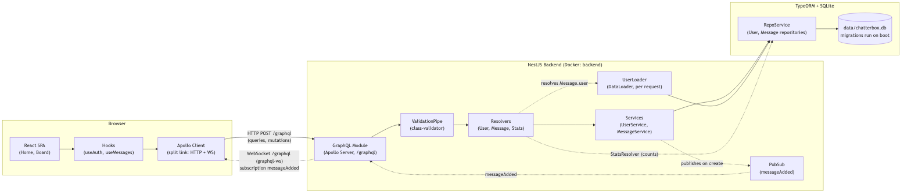

# GraphQL Message Board

Real-time message board: NestJS + GraphQL + TypeORM/SQLite backend, React + Apollo Client frontend, live updates via the `messageAdded` subscription.



## Stack

- **Backend:** NestJS 10, GraphQL 16 (Apollo Server, code-first), TypeORM 0.3, SQLite, DataLoader, class-validator
- **Frontend:** React 18, Apollo Client 3 (HTTP + `graphql-ws`), React Router 6, styled-components 6
- **Tests:** Jest, React Testing Library, Supertest, Newman (Postman), Playwright

Requires Node.js 24+ and Docker.

## Quick start

```bash
docker compose up --build
```

- Frontend: http://localhost:3000
- API / Playground: http://localhost:3333/graphql

Without Docker:

```bash
cd back-end && npm install && npm run start:dev   # terminal 1
cd front-end && npm install && npm start          # terminal 2
```

No env vars are required. See [docs/architecture.md](docs/architecture.md#configuration) for optional ones.

## Tests

| Layer | Command | Needs |
|---|---|---|
| Backend unit (100% coverage) | `cd back-end && npm run test:cov` | — |
| Backend E2E | `cd back-end && npm run test:e2e` | — |
| Frontend unit (100% coverage) | `cd front-end && npm run test:cov` | — |
| Postman collection | `cd back-end && npm run test:collection` | backend running |
| Integration (curl) | `bash e2e-integration-test.sh` | full stack running |
| Browser E2E | `cd e2e && npm install && npx playwright install chromium && npm test` | full stack running |

Every operation is tested on its happy and sad paths — see the coverage matrix in [docs/testing.md](docs/testing.md).

## Project structure

```
back-end/    NestJS GraphQL API
front-end/   React SPA
e2e/         Playwright browser tests
docs/        Docs, diagrams (mmd/ → img/), Postman collection
```

## Documentation

- [Architecture & configuration](docs/architecture.md)
- [GraphQL API](docs/api.md)
- [Testing & CI](docs/testing.md)
- [Security notes](docs/security.md)
- [Backend](back-end/README.md) · [Frontend](front-end/README.md) · [Browser E2E](e2e/README.md)
