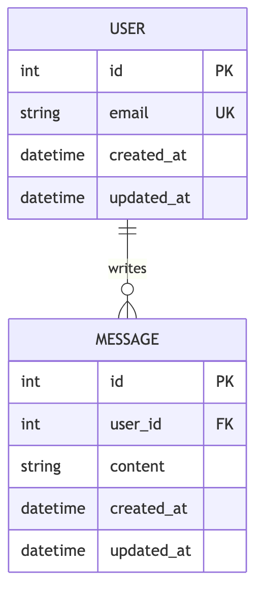
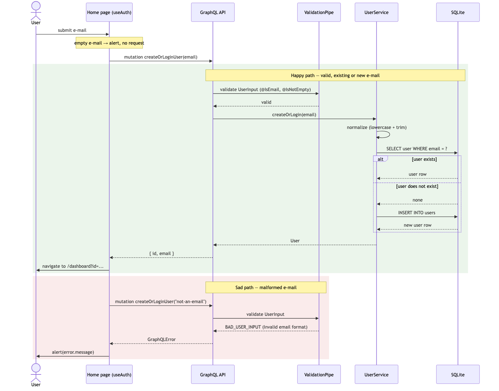
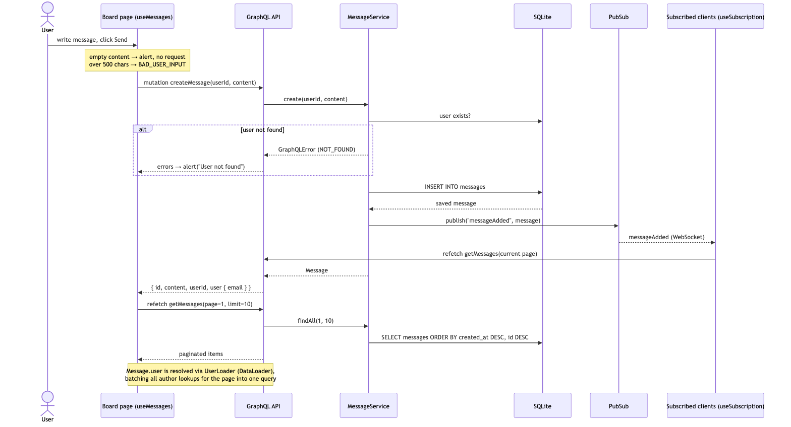
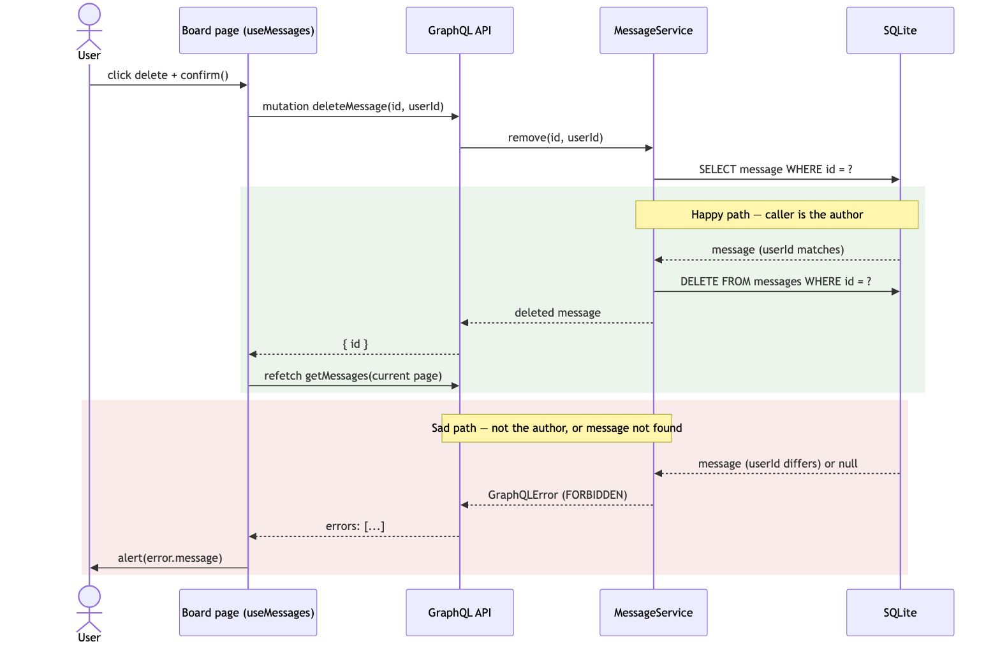
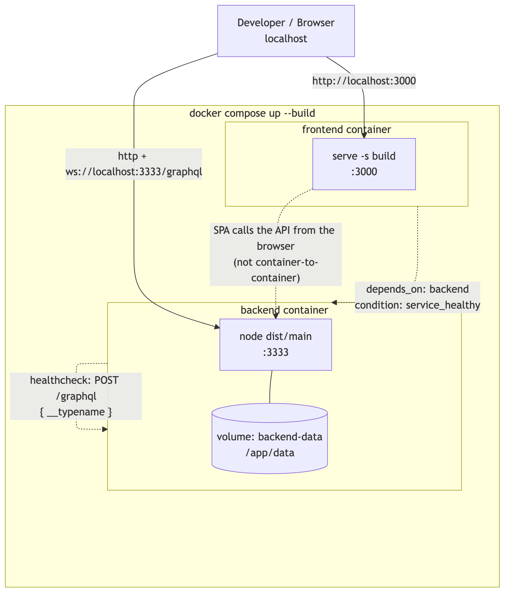

# Architecture


## Layers

- **Backend:** Resolver → Service → Repository. Resolvers only map arguments; `UserService` and `MessageService` own the business rules (email normalization, ownership checks, pagination) and use TypeORM repositories via `RepoService`.
- **Frontend:** hooks (`useAuth`, `useMessages`) own GraphQL calls and validation; pages (`Home`, `Board`) are presentational.

## Data model



`messages.user_id → users.id` is a real foreign key with `ON DELETE CASCADE`: deleting a user deletes their messages.

## Key behaviors

| Topic | How |
|---|---|
| Migrations | Run automatically on boot (`migrationsRun: true`); tests use in-memory SQLite with `synchronize` (entities mirror the migrations, including the cascade). |
| Validation | Shared `createValidationPipe()` (`whitelist`, `forbidNonWhitelisted`, `transform`) + `class-validator` on every input; failures become `BAD_USER_INPUT` with the real messages. Used by `main.ts` and the e2e suite. |
| Errors | `GraphQLError` with `extensions.code`: `NOT_FOUND`, `FORBIDDEN`, `BAD_USER_INPUT`. |
| N+1 | `UserLoader` (DataLoader) created per request in the GraphQL context; resolves `Message.user`. |
| Real time | `createMessage` publishes `messageAdded` on an in-memory PubSub; served over WebSocket (`graphql-ws`). The frontend uses a split link (HTTP for queries/mutations, WS for subscriptions) and refetches on each event. |
| CORS | `app.enableCors()` — required for the SPA (`:3000`) to call the API (`:3333`). |
| Playground | Enabled unless `NODE_ENV=production`. |

## Flows

### Login / register


### Create message


### Delete message


## Docker Compose



- `backend` has a healthcheck (`POST /graphql { __typename }`); `frontend` starts only when it is healthy.
- SQLite data persists in the `backend-data` volume (`docker compose down -v` wipes it).

## Configuration

Every value has a working default.

| App | Variable | Default | Purpose |
|---|---|---|---|
| Backend | `NODE_ENV` | unset | `production` disables the Playground; `test` uses an in-memory DB. |
| Frontend | `REACT_APP_GRAPHQL_URL` | `http://localhost:3333/graphql` | API endpoint; the WS URL is derived from it. Build-time only — see [`.env.example`](../front-end/.env.example). |

## Diagrams

Sources live in [`mmd/`](mmd) and are rendered to [`img/`](img). Regenerate with:

```bash
cd docs
for f in mmd/*.mmd; do npx -y @mermaid-js/mermaid-cli -i "$f" -o "img/$(basename "$f" .mmd).png" -b white -s 2; done
```
