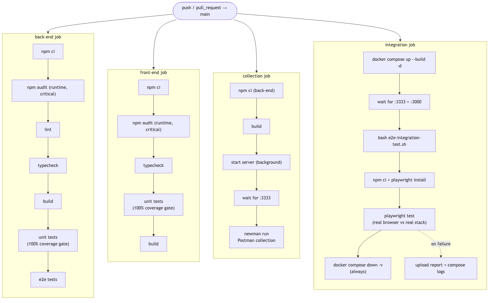

# Testing & CI

## Layers

| Layer | Location | Count | Scope |
|---|---|---|---|
| Backend unit | `back-end/src/**/*.spec.ts` | 89 tests / 17 suites, **100% coverage** | Services, resolvers, validation pipe, schema, migrations, config, bootstrap |
| Backend E2E | `back-end/test/graphql.e2e-spec.ts` | 69 tests | Every operation over HTTP + the subscription over WebSocket (in-memory DB) |
| Frontend unit | `front-end/src/**/*.test.tsx` | 44 tests / 9 suites, **100% coverage** | Hooks, pages, routes, Apollo client config, entry point, styles |
| Postman collection | `docs/postman/` | 59 requests / 232 assertions | Every query and mutation against a running API |
| Integration | `e2e-integration-test.sh` | 45 checks | Running containers: SPA, CORS, every operation, WebSocket subscription, cascade |
| Browser E2E | `e2e/tests/full-stack.spec.ts` | 18 tests | Real Chromium vs. real stack: every UI route and flow |

Unit coverage is enforced at 100% (statements, branches, functions, lines) via `coverageThreshold`; CI fails below it.

## Coverage matrix

✅ = happy and sad paths covered; sad paths assert the error code **and** message. The browser column lists operations the UI itself calls (the suite also verifies results via the API).

| Operation | Backend E2E | Postman | Integration | Browser |
|---|---|---|---|---|
| `getStats` | ✅ | ✅ | ✅ | — |
| `getUser` | ✅ | ✅ | ✅ | — |
| `getUsers` | ✅ | ✅ | ✅ | — |
| `createOrLoginUser` | ✅ | ✅ | ✅ | ✅ |
| `updateUser` | ✅ | ✅ | ✅ | — |
| `deleteUser` (+ cascade) | ✅ | ✅ | ✅ | — |
| `getMessage` | ✅ | ✅ | ✅ | — |
| `getMessages` | ✅ | ✅ | ✅ | ✅ |
| `getMessagesFromUser` | ✅ | ✅ | ✅ | — |
| `createMessage` | ✅ | ✅ | ✅ | ✅ |
| `updateMessage` | ✅ | ✅ | ✅ | — |
| `deleteMessage` | ✅ | ✅ | ✅ | ✅ |
| `messageAdded` | ✅ | n/a¹ | ✅ | ✅ |
| Malformed requests | ✅ | ✅ | ✅ | — |

¹ Newman has no WebSocket support.

The UI only uses login, the board and delete; the browser suite covers every route (`/`, `/dashboard`, 404) and flow: register, login, invalid/empty e-mail, send, empty/too-long message, missing or deleted user, delete and cancel, own vs. others' messages, pagination, live updates, and a rejected message not being pushed.

Sad paths per input: invalid/empty/missing values, non-positive ids, wrong types, `page < 1`, `limit` outside 1–100, content empty or over 500 chars, nonexistent ids, non-author access, duplicate email.

## Running everything

```bash
# Isolated
cd back-end  && npm run lint && npx tsc --noEmit && npm run test:cov && npm run test:e2e
cd front-end && npx tsc --noEmit && npm run test:cov

# Full stack
docker compose up --build -d
cd e2e && npm install && npx playwright install chromium && npm test
bash e2e-integration-test.sh
cd back-end && npm run test:collection
docker compose down -v
```

## Bugs found by testing

- Fresh databases had no tables (migrations never ran on boot).
- `getMessagesFromUser` failed under the real `ValidationPipe` (merged `@Args()`).
- No CORS policy — the browser blocked every request.
- The `messages → users` foreign key was never created, so deleting a user orphaned messages.
- Google Fonts `@import` inside `createGlobalStyle` was dropped in production builds.
- `messageAdded` worked on the backend but the frontend was HTTP-only; fixed with `graphql-ws` and a split link.
- `createMessage` for a nonexistent user leaked a raw `SQLITE_CONSTRAINT` error; now `NOT_FOUND`.
- Validation errors surfaced as `"Bad Request Exception"` (`BAD_REQUEST`); now the real message with `BAD_USER_INPUT`.
- The entity lacked `onDelete: 'CASCADE'`, so the test schema diverged from the migrations.
- Ordering only by `created_at` (1-second precision) made pages repeat or skip messages; now `created_at DESC, id DESC`.

## CI

`.github/workflows/ci.yml` runs four parallel jobs on every push/PR to `main`:



Plus `infra` (`terraform fmt`/`validate` of `infra/` and `bootstrap/`) and, on pushes to `main` once configured, `deploy`: it deploys to AWS and runs `e2e-integration-test.sh` against the live CloudFront URL (see [Deployment](deployment.md)). [`destroy.yml`](../.github/workflows/destroy.yml) tears the AWS stack down on demand.
